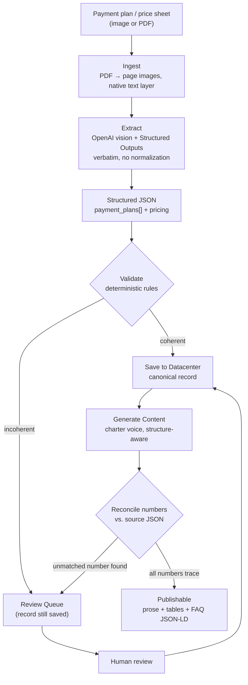

# Payment Plan → SEO/AEO Content Engine

Ingests a real-estate project's payment plan or price sheet — as an image or PDF, in whatever format the developer printed it — and turns it into structured data and publish-ready SEO/AEO content for the Project Detail Page (PDP).

Built for Square Yards' PDP content family. Uses OpenAI's vision models for extraction (Structured Outputs / strict JSON schema) and text generation for content, with deterministic validation on both ends.

---

## Problem Statement

- Developers publish payment plans and price sheets in wildly inconsistent formats — scanned images, PDFs, price-sheet PDFs with an embedded schedule, multi-plan sheets, tower-wise or unit-wise variants.
- There is **no fixed structure**: some plans are percentage-based, some are absolute amounts, some are compound ("10% + ₹2L"), some are pure text ("Balance on possession"), and many carry footnote conditions (GST extra, registration extra) that change what content is allowed to say.
- Manually transcribing these into SEO copy for every project is slow, inconsistent in tone, and error-prone on numbers — and payment-plan errors are a trust/legal issue, not just a content-quality one.
- The PDP already has a mature, rules-first content system (voice charter, HTML/AEO standards, validation gates) for other sections. Payment plans need to join that family without forcing a shape onto data that doesn't have one.

## Solution

A six-stage pipeline that treats **structured extraction and content generation as two separately-validated problems**, joined by a canonical JSON record:

- **Flexible-by-design schema** — no assumption of a single plan shape. Multiple plans, mixed value types (`percentage` / `amount` / `percentage_plus_amount` / `text`), and a `notes` escape hatch so nothing gets silently dropped or invented.
- **Vision-model extraction, not OCR** — a vision-capable LLM reads the image/PDF directly into strict JSON (OpenAI Structured Outputs), which handles tables, merged cells, and Hinglish labels far better than OCR + text parsing, and makes parse failures impossible by construction.
- **Extract verbatim, validate deterministically** — the model is instructed to copy what's printed with zero normalization; a separate, non-LLM validation layer does the arithmetic (percentage sums, price reconciliation, plan-type confirmation) and decides what's safe to auto-publish vs. what needs human review.
- **Canonical datacenter record** — validated JSON is saved once per project and becomes the single source of truth. Content can be regenerated anytime (charter updates, new AEO formats) without re-touching the source document, and the same record can feed other consumers later (comparison modules, chatbot answers).
- **Charter-voice content generation with a numeric safety net** — since there's no variable injection here (unlike the rest of the PDP system), every number in the generated content is reconciled back against the source JSON after generation. Anything that doesn't trace to the source blocks publish.

## Agenda

- [x] Design a schema flexible enough for real developer variability (multi-plan sheets, mixed value types, price-sheet-with-schedule documents)
- [x] Build ingestion for both images and multi-page PDFs (single-request extraction so split tables aren't read as two plans)
- [x] Implement OpenAI vision extraction with strict Structured Outputs
- [x] Implement deterministic, per-plan-type validation with a tolerance-aware reconciliation engine
- [x] Persist validated records to a swappable datacenter client
- [x] Implement charter-voice SEO/AEO content generation, structure-aware by plan type
- [x] Implement post-generation numeric reconciliation as the safety net replacing variable injection
- [ ] Wire in the production Senior Real Estate Writer voice charter v2.0 (currently a placeholder block)
- [ ] Wire in the real Square Yards datacenter API client (currently a file-based stand-in)
- [ ] Validate extraction accuracy against a batch of real developer PDFs and tune DPI / prompt as needed

## Process

1. **Ingest** — accept an image or PDF; PDFs are rasterized page-by-page (PyMuPDF) and all pages are sent together so a milestone table split across pages is read as one plan.
2. **Extract** — a single OpenAI vision call converts the document into the strict JSON schema, instructed to extract verbatim with no normalization, no unit conversion, and no inferred milestones.
3. **Structure** — the extraction output *is* the structured data (schema-guaranteed); document type (`payment_plan_only` / `price_sheet_with_payment_schedule` / etc.) and plan multiplicity are captured explicitly.
4. **Validate** — deterministic rules run per plan type: percentage sums to 100 (±0.5 tolerance) only when every milestone is percentage-type; price-sheet arithmetic reconciles component sums, GST, and grand totals (±₹1 rounding tolerance); the model's proposed plan type is confirmed or overridden by structural rules; anything incoherent routes to a review queue instead of failing outright.
5. **Save** — the validated record, plus the full validation report and internal-only derived signals (e.g. city inferred from utility-board references), is written to the project datacenter as the canonical record.
6. **Generate** — content generation reads the canonical record (never the raw extraction) and produces charter-voice prose, semantic HTML tables (schedule + pricing), and FAQPage JSON-LD, branching its narrative framing on the confirmed plan type.
7. **Reconcile** — every number in the generated content is checked against the source JSON (exact lakh/crore restatements allowed); any number that doesn't trace back blocks publish and flags the content for review.

## Flow



---

## Repository Structure

```
payment_plan_pipeline/
├── main.py                          # CLI entry point
├── requirements.txt
├── payment_pipeline/
│   ├── config.py                    # models, DPI, tolerances, page caps
│   ├── schema.py                    # OpenAI Structured Outputs JSON schema
│   ├── ingest.py                    # image/PDF ingestion, PDF rasterization
│   ├── extraction.py                # vision extraction call + verbatim prompt
│   ├── validation.py                # deterministic per-plan-type validation
│   ├── datacenter.py                # canonical record persistence
│   ├── content_generation.py        # charter-voice generation + reconciliation
│   └── pipeline.py                  # orchestrator
└── sample_data/                     # (add sample payment plan images/PDFs here)
```

## Setup

```bash
pip install -r requirements.txt
export OPENAI_API_KEY=sk-...
```

## Usage

```bash
python main.py path/to/price_sheet.png --project-id divine-green-leaf
```

**Outputs:**
- `./datacenter_store/<project-id>.payment_plan.json` — canonical extraction record (extraction + validation report + derived signals)
- `./output/<project-id>.content.json` — generated content package (`seo_prose_html`, `payment_schedule_table_html`, `pricing_table_html`, `faq_jsonld`, `meta_description`) with its reconciliation report

If validation routes the record to review, content generation is skipped. After human review, re-run with `--force-generate`.

## Key Design Decisions

| Decision | Why |
|---|---|
| No fixed plan structure assumed | Real developer payment plans vary too much for a rigid schema — flexible core (array of plans, discriminated milestone value types) + `notes` escape hatch |
| Vision LLM over traditional OCR | Preserves table structure directly; traditional OCR loses it and needs messy post-processing |
| Extract verbatim, normalize never (in the vision call) | Keeps the extraction step auditable; any normalization needed happens later in deterministic code |
| Validation is per-plan-type, not one-size-fits-all | Sum-to-100 is meaningless for amount- or text-based plans; rules branch on what the plan actually is |
| Datacenter record is canonical, not the raw extraction | Content can be regenerated on charter/format changes without re-running extraction |
| Post-generation numeric reconciliation | Free-text generation has no variable injection to guarantee correctness, so every number is checked back against source JSON after the fact |
| Derived signals (city, construction status) stored, never published | They're for internal master-data cross-checks, not verified facts fit for public content |

## Production Integration Points

- `payment_pipeline/datacenter.py` — replace `FileDatacenterClient` with the real datacenter API client (same two-method interface: `save`, `load`).
- `payment_pipeline/content_generation.py` — paste the production **Senior Real Estate Writer voice charter v2.0** into `VOICE_CHARTER`, and align the HTML rules block with the PDP HTML/CSS standards document.
- `payment_pipeline/config.py` — tune models, DPI, tolerances, and page caps here.

## Roadmap

- [ ] Batch mode for processing multiple projects' payment plans in one run
- [ ] Confidence-based auto-routing thresholds tuned from real review-queue data
- [ ] Optional human-review UI for the review queue instead of file-based inspection
- [ ] Extend `plan_type` structural classifier as new plan shapes are observed in production

## License

Proprietary — Deepesh Kumar Gupta
